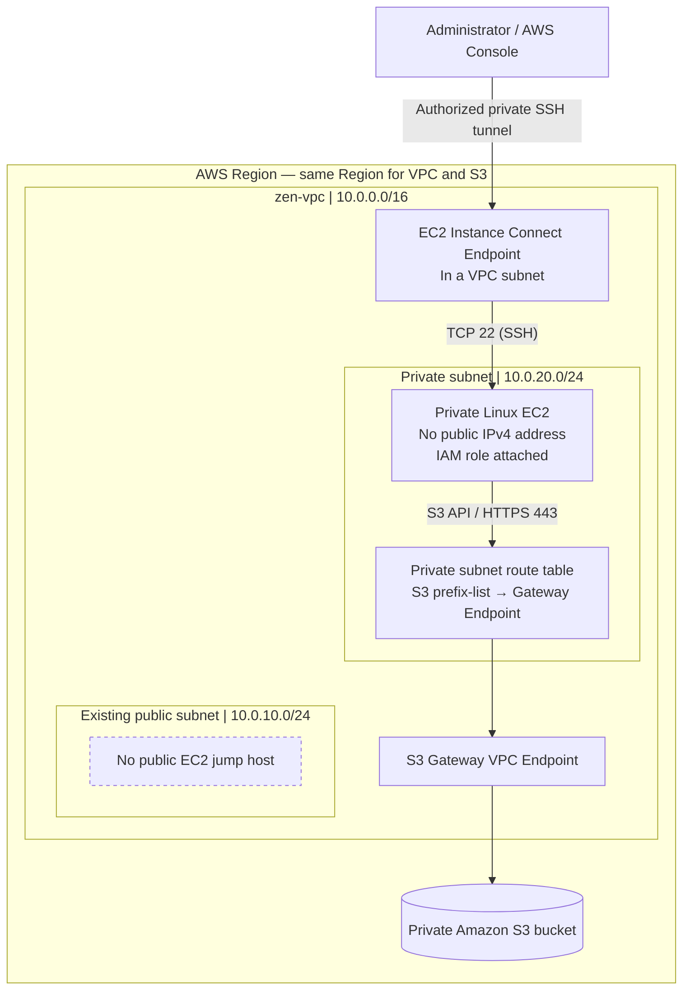

# AWS Lab #2 — Private EC2 to Amazon S3 via Gateway VPC Endpoint

> **Project:** AWS Private Networking, IAM and S3  
> **Status:** Completed  
> **Lab environment:** Existing `zen-vpc` from Lab #1  
> **Access method:** **EC2 Instance Connect Endpoint (EICE)** — **no public EC2/bastion host or SSH ProxyJump**

## Project overview

This hands-on lab demonstrates how an Amazon EC2 instance running in a **private subnet** can securely access an **Amazon S3 bucket** using an **S3 Gateway VPC Endpoint**. The EC2 instance receives its S3 permissions from an **IAM role**, rather than from long-lived access keys.

For administration, I used an **EC2 Instance Connect Endpoint** to connect to the private EC2 instance. This replaces the public EC2 jump-host/ProxyJump approach originally considered. The public EC2 instance from my previous lab had already been deleted.

**Two separate connections are used:**

1. **Administration:** AWS Console / authorized administrator → **EC2 Instance Connect Endpoint** → private EC2 (SSH).
2. **S3 data access:** Private EC2 → **S3 Gateway VPC Endpoint** (via the private subnet's route table) → S3 bucket.

These endpoints solve different problems: **EICE provides managed private-instance access; the S3 Gateway Endpoint provides routing to S3 without a NAT Gateway or Internet Gateway.**

## Architecture



*Conceptual diagram: the S3 Gateway Endpoint is represented as a route-table destination/target, not as a separate EC2 instance or SSH proxy. The EICE is a separate endpoint with an AWS-managed endpoint network interface.*

## AWS resources

| Resource | Configuration / purpose |
|---|---|
| VPC | Existing `zen-vpc`, `10.0.0.0/16` |
| Public subnet | Existing `10.0.10.0/24`; **no public jump-host EC2 used** |
| Private subnet | Existing `10.0.20.0/24` |
| EC2 | Amazon Linux 2023 private instance; **public IPv4 disabled** |
| EC2 instance IAM role | Grants bucket-scoped S3 permissions; example name: `ZenPrivateEC2S3Role` |
| IAM policy | List, read, and upload objects in the lab bucket; example name: `ZenS3PrivateAccessPolicy` |
| S3 bucket | Private, unique bucket name; public access blocked, SSE-S3 default encryption |
| S3 Gateway VPC Endpoint | Regional service `com.amazonaws.<region>.s3`, associated with the private subnet route table |
| EC2 Instance Connect Endpoint | Secure management connection to the private instance; **replaces SSH jump host** |
| Security groups | Private EC2 permits SSH from the EICE path; outbound HTTPS to S3 is allowed |

> **Naming note:** Role, policy, bucket, instance, and endpoint names above are illustrative where an exact deployed value is not recorded. Replace placeholders with your actual resource values before publishing.

## Implementation

### 1. Reused the VPC and private subnet

- Selected `zen-vpc` (`10.0.0.0/16`) from Lab #1.
- Reused the private subnet `10.0.20.0/24`.
- Confirmed the private instance does not have a public IPv4 address.
- Identified the **route table actually associated with the private subnet**.
- No new public EC2/bastion host was launched.

### 2. Created a private S3 bucket

- Created a general-purpose S3 bucket in the same AWS Region as the VPC.
- Left **Block all public access** enabled.
- Kept **ACLs disabled (Bucket owner enforced)**.
- Used S3-managed encryption (SSE-S3).
- Uploaded a small test object, for example `zen-test.txt`.

### 3. Created a least-privilege IAM policy and EC2 role

The following example policy permits listing the selected bucket and reading/writing objects in it, but **not deleting objects**. Replace `YOUR-BUCKET-NAME` with the actual bucket name in **both** resource ARNs.

```json
{
  "Version": "2012-10-17",
  "Statement": [
    {
      "Sid": "AllowListLabBucket",
      "Effect": "Allow",
      "Action": "s3:ListBucket",
      "Resource": "arn:aws:s3:::YOUR-BUCKET-NAME"
    },
    {
      "Sid": "AllowReadWriteLabObjects",
      "Effect": "Allow",
      "Action": ["s3:GetObject", "s3:PutObject"],
      "Resource": "arn:aws:s3:::YOUR-BUCKET-NAME/*"
    }
  ]
}
```

- Created an IAM role with **AWS service → EC2** as the trusted entity.
- Attached the S3 access policy to the role.
- Assigned the role to the private EC2 instance as its **IAM instance profile**.
- Did **not** store access key IDs or secret access keys on the instance.

**IAM controls *what* the instance can do. Network endpoints control *how* it reaches a service.** Both are part of this architecture.

### 4. Launched the private EC2 instance

- Selected the existing VPC and **private subnet**.
- Disabled automatic public IPv4 assignment.
- Attached the EC2 IAM role and an appropriate security group.
- Used Amazon Linux 2023 and AWS CLI v2 for S3 tests.

### 5. Created an EC2 Instance Connect Endpoint — updated connection method

I used an **EC2 Instance Connect Endpoint** rather than creating a public jump host or configuring `ProxyJump` on my Mac.

High-level configuration:

1. Opened the **Amazon VPC / EC2 Instance Connect Endpoints** configuration in the AWS console.
2. Created an **EC2 Instance Connect Endpoint** associated with `zen-vpc` and a suitable subnet.
3. Configured endpoint and instance security groups so management traffic can reach the private EC2 on **TCP 22**.
4. Used IAM-authorized EC2 Instance Connect to open a private SSH session to the instance.
5. Did not assign a public IP to the target EC2.

**Security-group detail:** With the endpoint's default setting (**client IP preservation off**), the target instance receives traffic sourced from the endpoint network interface; a narrowly scoped rule allowing TCP 22 from the **EICE security group** is appropriate. The EICE security group must permit outbound TCP 22 to the instance. If **client IP preservation is enabled**, the target instance's inbound rule must instead allow the preserved client IP or appropriate client CIDR, and additional AWS restrictions apply.

#### How to reconnect through the AWS Console

1. Open **EC2 → Instances**.
2. Select the private Linux EC2 instance, then choose **Connect**.
3. Open the **EC2 Instance Connect** tab.
4. Choose **Connect using a Private IP**.
5. Select the **EC2 Instance Connect Endpoint** created for this VPC.
6. Choose the correct Linux username (typically `ec2-user` for Amazon Linux).
7. Click **Connect** to open the browser-based terminal.

**Not used in this lab:** Public EC2 bastion host, Mac-to-bastion `ProxyJump`, SSH exposure to `0.0.0.0/0`, or a public IPv4 address on the private instance.

### 6. Created the S3 Gateway VPC Endpoint

1. Opened **VPC → Endpoints → Create endpoint**.
2. Selected the AWS service `com.amazonaws.<region>.s3` with endpoint type **Gateway**.
3. Selected `zen-vpc`.
4. Associated the endpoint with the **private subnet's route table**.
5. Used the endpoint's full-access policy for the initial lab, while the EC2 IAM policy restricted bucket actions.
6. Verified that AWS added an S3 managed-prefix-list route with the gateway endpoint as target.

Example route-table view (identifiers differ for each account):

| Destination | Target |
|---|---|
| `10.0.0.0/16` | `local` |
| `pl-xxxxxxxx` (regional S3 prefix list) | `vpce-xxxxxxxx` (S3 Gateway Endpoint) |

The S3 endpoint route enables communication with S3 **without requiring a NAT Gateway or internet access for this S3 traffic**. It does *not* provide connectivity to arbitrary AWS APIs or the public internet.

## Validation and tests

From the **private EC2 instance's terminal opened via the EC2 Instance Connect Endpoint**, set the following variables to your actual values:

```bash
BUCKET="YOUR-BUCKET-NAME"
REGION="YOUR-REGION"  # Example: us-east-1
```

### Verify AWS CLI

```bash
aws --version
```

### Test listing S3 objects

```bash
aws s3 ls "s3://$BUCKET" --region "$REGION"
```

### Download an object

```bash
aws s3 cp "s3://$BUCKET/zen-test.txt" ./zen-test.txt --region "$REGION"
cat zen-test.txt
```

### Upload an object

```bash
echo "Uploaded securely from private EC2" > private-upload.txt
aws s3 cp private-upload.txt "s3://$BUCKET/private-upload.txt" --region "$REGION"
```

### Verify the IAM restriction on deletion

```bash
aws s3 rm "s3://$BUCKET/private-upload.txt" --region "$REGION"
```

**Expected result when the example IAM policy is applied and no other policy grants delete:** `AccessDenied`, because the role has no `s3:DeleteObject` permission.

> A successful S3 test alone does not prove which network path was used if a NAT route also exists. Verify the associated private route table contains the S3 prefix-list route targeting the gateway endpoint. To validate endpoint-only access, perform the test without an alternate internet/NAT path, while avoiding disruptions to other resources.

> `aws sts get-caller-identity` is **not** a required connectivity test here: an S3 Gateway Endpoint does not provide access to AWS STS. STS calls from a private-only subnet need their own permitted network path.

## Security takeaways

- **Private compute:** The EC2 instance is deployed without a public IP address.
- **Private administration:** EC2 Instance Connect Endpoint allows IAM-authorized management access without a bastion EC2 or public SSH endpoint.
- **Least-privilege authorization:** EC2 uses an instance IAM role restricted to one bucket and selected actions.
- **Private S3 path:** A Gateway VPC Endpoint routes S3 traffic from the private subnet without NAT.
- **Access separation:** EICE is for administrator-to-EC2 access; S3 Gateway Endpoint is for EC2-to-S3 access.
- **Layered controls:** Security groups, route tables, IAM permissions and S3 bucket settings each address different security concerns.
- **Further hardening:** Narrow the S3 Gateway Endpoint policy and consider a bucket policy that restricts access via a designated `aws:SourceVpce` where appropriate; carefully test for unintended access lockouts.

## Cost considerations and cleanup

- **S3 Gateway VPC Endpoint:** No additional endpoint charge.
- **EC2 Instance Connect Endpoint:** No additional endpoint charge; cross-Availability Zone data transfer can incur charges.
- **Potential costs:** EC2 compute, EBS volume storage, S3 requests/storage, and any other retained billable infrastructure.
- **After testing:** Stop or terminate unused EC2 instances; review attached EBS volumes and S3 objects; check for unused NAT Gateways, Elastic IPs, and other billable resources.

## Challenges solved

**Original plan:** Connect from my Mac to a public EC2 jump host, then SSH into the private EC2 using `ProxyJump`.

**Actual implementation:** My original public EC2 had been deleted, so I created an **EC2 Instance Connect Endpoint** and connected directly to the private instance through AWS-managed private connectivity.

**Lesson learned:** A public bastion instance is not always necessary for private-instance administration. IAM-controlled managed connectivity can reduce the need for publicly reachable management infrastructure.

## Suggested evidence / screenshots

If adding screenshots to this repository, remove sensitive details first. Useful screenshots include:

- `screenshots/vpc-subnets.png` — VPC and private subnet.
- `screenshots/private-ec2.png` — private address and no public IPv4.
- `screenshots/ec2-instance-connect-endpoint.png` — EICE configuration.
- `screenshots/iam-role-policy.png` — attached instance role and policy.
- `screenshots/s3-gateway-endpoint.png` — S3 gateway endpoint.
- `screenshots/private-route-table.png` — S3 prefix-list route.
- `screenshots/s3-cli-tests.png` — successful object list/download/upload and expected delete denial.

## What I learned

Through this lab I practiced:

- VPC subnet and route-table inspection
- Private Linux EC2 administration with EC2 Instance Connect Endpoint
- S3 bucket configuration and object operations with AWS CLI
- EC2 instance profiles, IAM roles, and least privilege
- Regional S3 Gateway Endpoints and S3 prefix-list routing
- Security-group rules for private management access
- Differentiating **authentication, authorization, and network connectivity**
- Basic AWS cost-aware resource management

## AWS documentation

- [Gateway endpoints for Amazon S3](https://docs.aws.amazon.com/vpc/latest/privatelink/vpc-endpoints-s3.html)
- [Connect to your instances using EC2 Instance Connect Endpoint](https://docs.aws.amazon.com/AWSEC2/latest/UserGuide/connect-with-ec2-instance-connect-endpoint.html)
- [Connect to an instance using EC2 Instance Connect Endpoint](https://docs.aws.amazon.com/AWSEC2/latest/UserGuide/connect-using-eice.html)
- [IAM roles for Amazon EC2](https://docs.aws.amazon.com/AWSEC2/latest/UserGuide/iam-roles-for-amazon-ec2.html)

---

**Lab outcome:** Demonstrated private EC2 administration through **EC2 Instance Connect Endpoint** and private, IAM-authorized access from EC2 to S3 through an **S3 Gateway VPC Endpoint**, with no public jump host.
